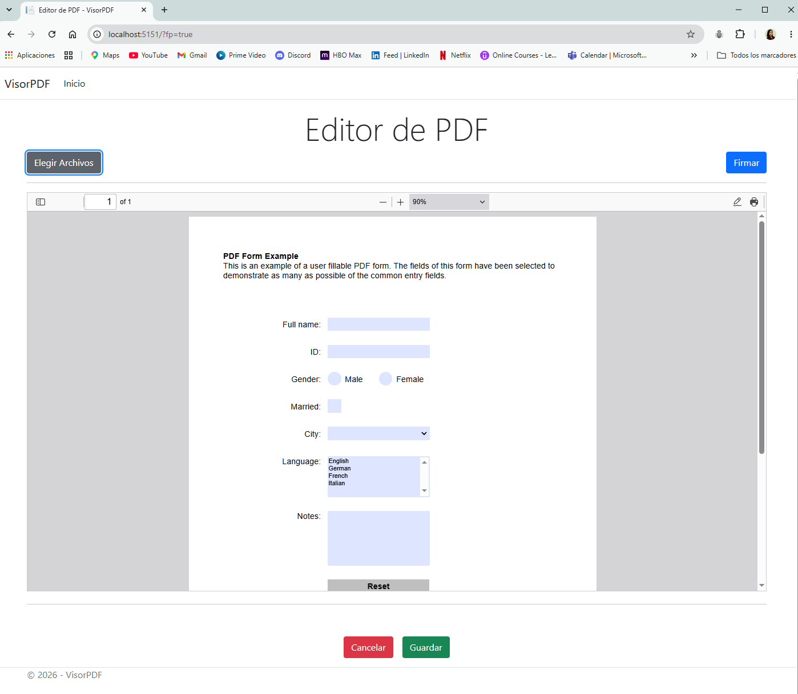
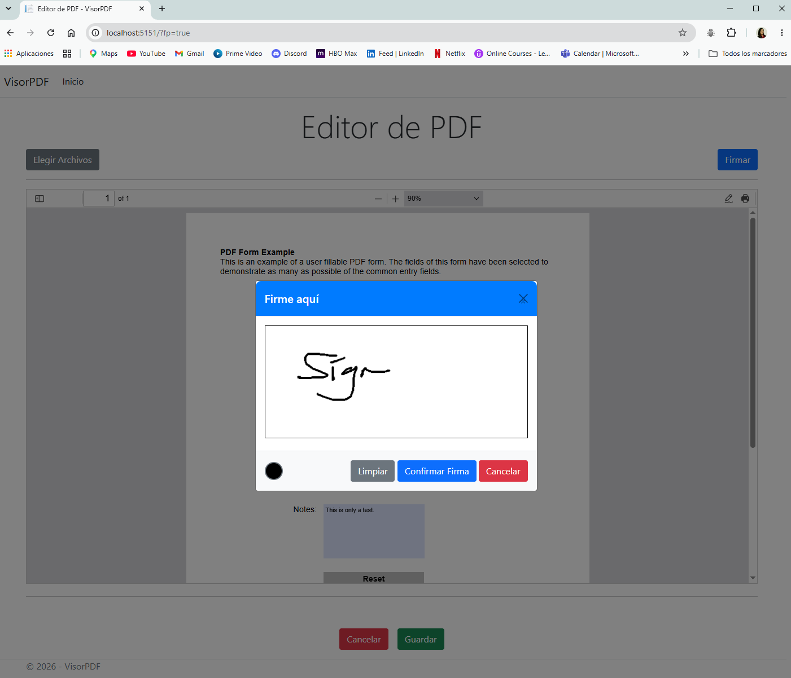
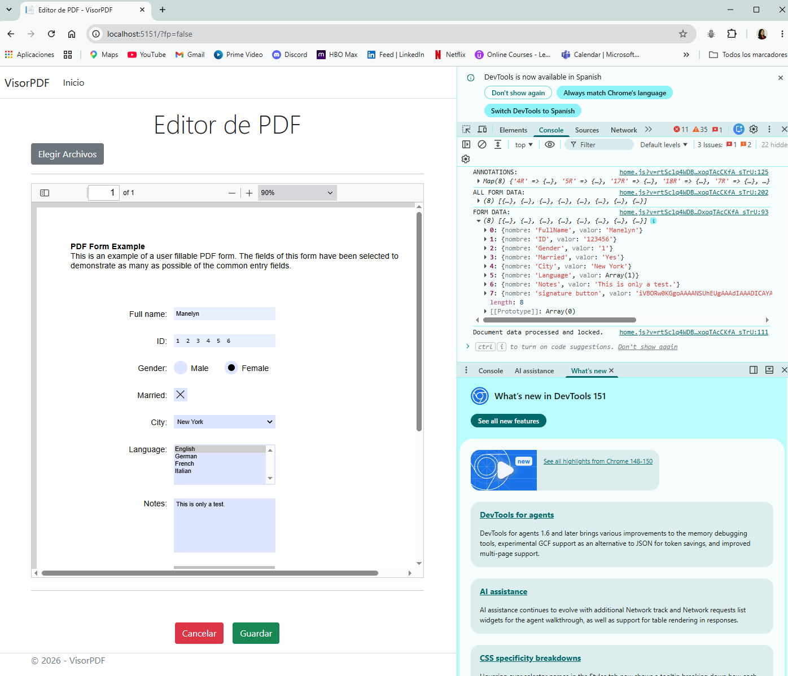

VisorPDF – PDF Form Editor & Data Processing Tool

A web-based PDF form editor and data processing tool developed during a Front-End Development internship. The project focuses on displaying interactive PDF forms, handling form data, annotations, and digital signatures using JavaScript and ASP.NET MVC.

📌 Project Overview

This project was developed collaboratively with two classmates during a Front-End Development internship.

The team researched and tested different free JavaScript PDF libraries and approaches before integrating the most suitable solutions into an existing ASP.NET MVC project.

The application allows users to interact with PDF forms and prepares their data for further processing by the backend.

✨ Features

📄 Display and interact with PDF documents 
📝 Read and process editable PDF form fields 
🔍 Extract PDF form field names and values 
📦 Convert extracted form data into structured JSON 
✍️ Add ink annotations to PDF documents 
🖊️ Capture digital signatures 
🔐 Convert captured signatures to Base64 for data processing 
⚙️ Integrate PDF functionality into an ASP.NET MVC application 

🛠️ Technologies & Tools

HTML5
CSS3
JavaScript
ASP.NET MVC
C#
PDF.js
pdf-lib
Bootstrap
jQuery
JSON
Visual Studio 2022

🏗️ Project Structure

VisorPDF/
│
├── Controllers/
├── Models/
├── Views/
├── wwwroot/
│   ├── css/
│   ├── js/
│   └── ...
│
├── Properties/
├── Program.cs
├── VisorPDF.csproj
├── appsettings.json
├── appsettings.Development.json
└── .gitignore

🔎 Main Technical Challenges

One of the main challenges was finding a free solution that could display and interact with PDF forms while fitting the existing ASP.NET MVC architecture.

Different approaches and JavaScript PDF libraries were researched and tested, including PDF.js and pdf-lib.

The project required working with PDF rendering, form fields, annotations, signature capture, and data extraction while adapting the implementation to an existing codebase.

👥 Collaboration

This was a collaborative internship project developed with two classmates.

The team independently researched possible solutions, tested different approaches, and integrated the selected functionality into the shared ASP.NET MVC application.

🚀 Running the Project Locally

Requirements

.NET 8 SDK
Visual Studio 2022 or another compatible .NET development environment

Run the application

Clone the repository:

git clone https://github.com/Manelynp/VisorPDF.git

Navigate to the project directory:

cd VisorPDF

Build the project:

dotnet build

Run the application:

dotnet run

Then open the local URL shown in the terminal.

📸 Screenshots

  
  
  

📚 Internship Context

Front-End Development Internship
Evolk Bigo Solutions – Vigo, Spain
March – April 2026 | 140 hours

This project provided practical experience working with JavaScript, DOM manipulation, PDF processing, form data, debugging, and integration with an existing ASP.NET MVC application.

